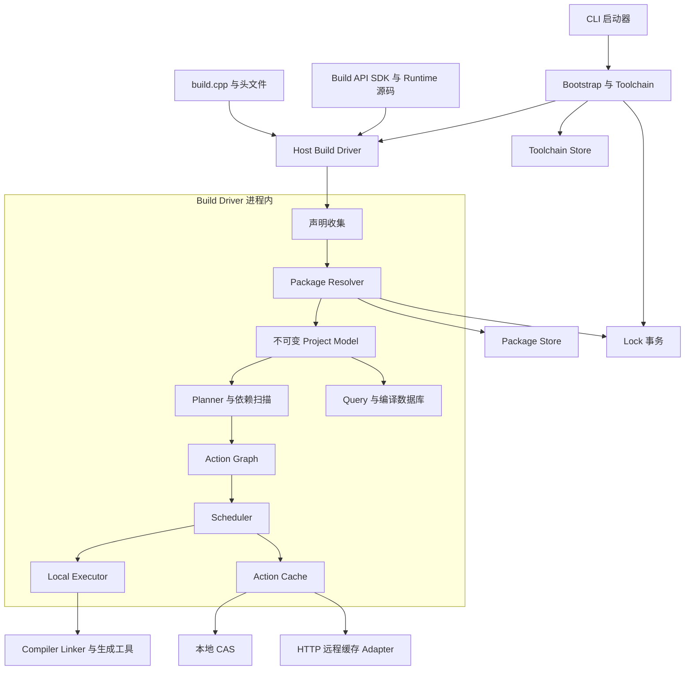
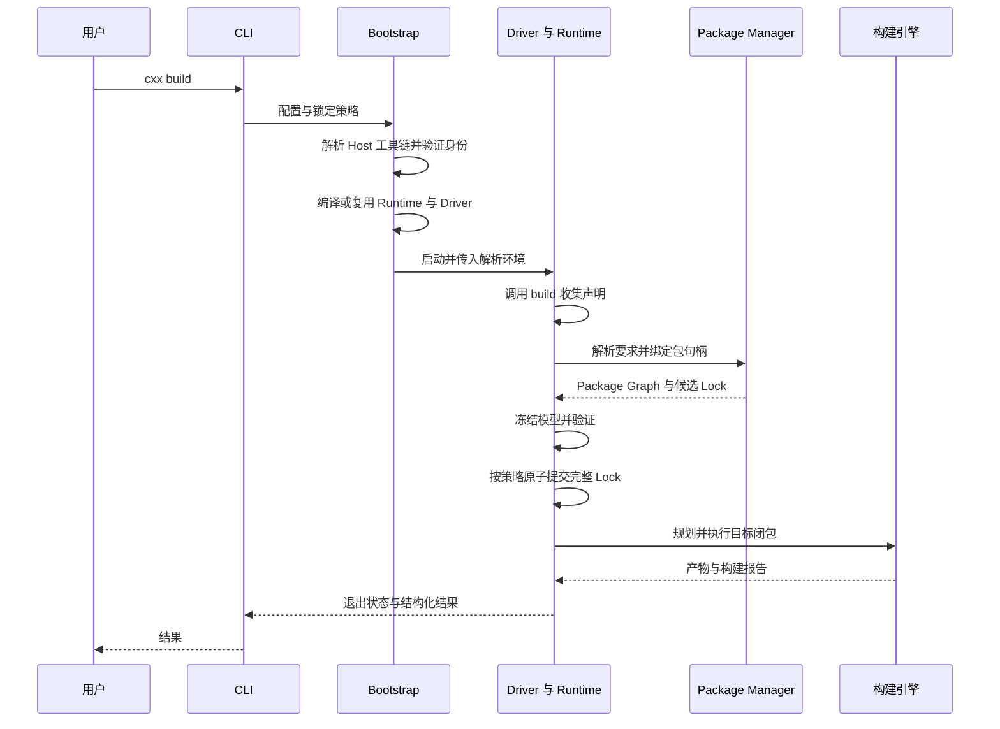
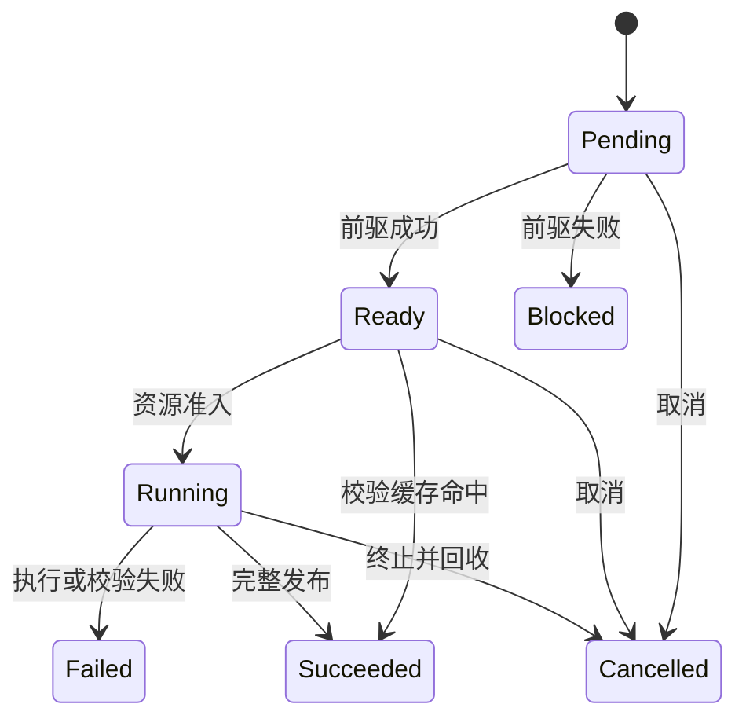

# CXX 架构设计 v1.0

**依据**：[CXX_PRD_v1.0.md](CXX_PRD_v1.0.md)  
**状态**：设计提案，待评审与原型验证；不代表 OPEN 项已获产品确认。  
**配套**：[实现计划](CXX_IMPLEMENTATION_PLAN_v1.0.md)、[领域术语](CONTEXT.md)。

## 1. 设计结论与范围

采用“轻量启动器 + 直接链接 Runtime 的 Host Build Driver + 原生构建引擎”。`build.cpp` 执行一次以声明项目；包解析后形成不可变 Project Model，再规划、扫描和执行 Action Graph。CXX 自行调度，编译器与链接器负责实际语言处理。

核心取舍：

1. Build Driver 是独立可执行文件，脚本、SDK 与 Runtime 使用一致的 Host ABI；避免加载任意编译器生成的 C++ 动态插件。
2. 包声明返回逻辑句柄，解析延迟到声明结束，打破“执行脚本需要先解析脚本所声明包”的循环。
3. 缓存正确性优先。动态依赖在编译缓存查询前确定；未知输入禁止共享缓存，历史 depfile 不能独自证明输入集合未变。
4. Toolchain 与 Package 共用一个原子提交的 Lock；CAS、Action Cache、Package Store、Toolchain Store 保持独立语义。
5. 先交付 Linux/Clang 端到端 V0，随后尽早建立三平台 CI；Modules、完整包管理和远程缓存按门槛逐项接入。

V1 范围沿用 PRD。Remote Execution、守护进程、任务 Hooks、通用 Rule DSL、全量 SDK 安装、自动修复和完整 IDE 插件交付均不进入实施承诺。V1 本地执行也不承诺容器或安全沙箱；第三方构建逻辑按可执行代码建立信任边界。

**事实边界**：本文编写时仓库仅有 PRD，格式、协议、接口与版本下限均为建议；只将 PRD 已确认行为当作约束。后续已开始 M0 实现，实际完成范围及验证证据见 [M0 进展](docs/M0_STATUS.md)。本文的 V1 设计不代表当前已交付能力。

## 2. 模块结构与依赖方向



图中箭头表示调用或数据依赖；启动器与 Driver 之间只传递命令参数、结构化启动输入及退出结果，**不传输构建图，不建立 IPC 构建服务**。模型构建、包解析、调度均在 Driver 内完成。

| 模块 | 对外 Interface 草案 | 封装的 Implementation 与约束 |
|---|---|---|
| Bootstrap | `prepare(request) -> DriverLaunch` | 根目录发现、配置校验、Host 工具链、SDK 构建、Driver 复用 |
| Toolchain Manager | `resolve(spec, lockPolicy) -> ResolvedToolchain` | Preset、组件覆盖、安装、能力探测和身份校验 |
| Build API | `build(Build&)`、声明句柄 | 声明收集、来源诊断、结构化环境；不暴露底层数据库 |
| Package Manager | `resolve(requirements, lockPolicy) -> PackageGraph` | 版本求解、来源 Adapter、包实例、ABI 筛选和源码回退 |
| Model/Planner | `finalize(declarations)`、`plan(model, request)` | 使用要求传播、配置展开、Action 生成与图验证 |
| Compiler Adapter | `probe/scan/compile/link` | Clang、GCC、MSVC 的命令、响应文件、依赖格式与功能矩阵 |
| Scheduler | `run(graph, budget, cancellation) -> BuildReport` | 就绪队列、资源准入、失败传播、防饥饿；不拼编译器命令 |
| Local Executor | `execute(action, context) -> ExecutionResult` | 三平台进程、工作目录、输出捕获和进程树取消 |
| Cache | `lookup/store/materialize` | 键校验、CAS 完整性、远程传输、暂存与发布 |
| State/Lock | `begin/commit`、快照读取 | Lock 原子替换、项目互斥、状态日志、崩溃恢复 |
| Query/Diagnostics | `query(snapshot, schema)`、诊断事件 | JSON、编译数据库、图、Explain、Trace；不解析终端文本 |

真实变化点才设置 Adapter：编译器、进程/监视平台、Package 来源、Cache 后端。Executor 保留值类型请求/结果的扩展接缝，V1 只有 Local Executor，不提前设计远程 RPC。

建议目录：`src/bootstrap/`、`toolchain/`、`package/`、`model/`、`engine/`、`cache/`、`platform/`、`query/`，以及 `sdk/`、`tests/fixtures/`、`tests/integration/`、`bench/`。公共 Build API 与内部执行类型分开，内部数据库结构不成为公共 Interface。

## 3. Bootstrap、Driver 与版本兼容

### 3.1 一次构建的流程



工具链可在提交 Lock 前完成验证安装；这些已验证的全局对象在后续失败时保留。Lock 只在工具链、包解析与模型基本验证全部成功后提交；后续编译失败不撤销已完成的合法解析，也不发布失败 Action 的结果。

### 3.2 ABI 策略

建议分发 SDK 头文件与可构建的 Runtime 源码包，按 Host 工具链身份、目标架构、标准库、CRT、异常/RTTI 和 ABI 相关选项缓存静态 Runtime。脚本与 Runtime 在同一 Host 工具链下编译，Driver 直接静态链接 Runtime。

- Core 与 Runtime 的实现标准为 C++23；脚本按 `cpp.version` 编译，最低支持 C++17。Host 工具链必须支持 CXX 所需的 C++23 能力；用户脚本使用 C++17 不要求 Host 编译器仅具备 C++17 能力。不同语言模式下的公共类型布局和头文件条件分支必须有 ABI 测试。
- 公共 Interface 使用 C++17 可表达的类型；跨脚本与 Runtime 的异常在同一 ABI 域处理。Driver 顶层捕获结构化错误、`std::exception` 和未知异常，转换统一诊断。
- Windows 对齐 CRT、调试迭代器与编译选项；禁止把不匹配的预编译 Runtime 当作通用二进制。
- 预编译 Runtime 仅是经验证 ABI 组合的加速选项；未匹配时从源码构建。
- Driver 是单入口 TU，可 include 项目头文件。V1 暂建议脚本自身不支持自定义 Modules；项目 Target 的 Modules 仍为 MUST。此范围须确认。
- 项目 Package 不参与 Driver 编译。脚本可使用 SDK、标准库、随项目提供的头文件；若要导入需链接的第三方脚本库，留作独立 bootstrap 扩展议题。

**Host/Target 分离**：`cxxrc.toml` 选择能够在 Host 上生成并运行 Driver 的 bootstrap 工具链；`build.cpp` 声明目标平台、交叉工具链、SDK 与 sysroot。Host 代码生成器与 Target 产物分别建模。仅能生成异构目标程序的 preset 用作 bootstrap 时明确报错，并提示配置 Host 工具链；具体 Host 选择 Interface 属于待确认决策 D04。

### 3.3 版本与能力

四个独立维度：CXX 可执行版本、Build API Edition、Query Schema、Lock Format；另有内部 Action 语义版本与 SDK 内容摘要。

- 业务 Action Key 使用真实命令语义、工具及输入；不常规加入 CLI 版本。
- SDK/Runtime 变化使 Driver 失效；会改变执行或键语义的内部变化升级相应语义标记。
- Edition 0 实验；Edition 1 稳定前建立旧源码兼容测试。升级 CLI 保留受支持旧 Edition 的解释行为。
- Core 最低编译器与标准库版本依据实际采用的 C++23 能力探针确定，P01 后冻结；原先基于 C++17 的版本候选作废。编译器接受 C++23 模式与所需标准库功能可用分别验证，第三方依赖需满足选定的版本下限。
- 标准模式通过编译探针检测，不把 `--version` 或接受 `-std=` 等同于完整语言支持。C++26 检查实际语言模式宏、所需功能探针，并报告“模式可用／具体功能未通过”；目标可覆写默认标准。
- 不同编译器、平台、标准库组合分别发布能力表，包括 Modules 扫描、PCH、Unity 和各组合限制。

## 4. 配置、工具链与环境身份

### 4.1 严格 Schema 和合并提案

Bootstrap 只接受 `[cxx]`、`[cpp]`、`[preset]` 与受支持工具组件段；未知字段报错，避免拼写错误被忽略。Profile、Target、Package、SDK 使用关系留在脚本。

建议算法，待 D03 确认：

1. 项目存在 bootstrap 配置时，其 preset 是选择入口；无项目选择才使用全局默认。项目配置中 `[preset].name` 必填。Edition 0、C++17 为缺省候选，默认标准需在 Schema 冻结时确认。
2. 根据名称选择项目 `.cxx/presets/`、用户 `~/.cxx/presets/`、内置中的第一个定义；整份定义遮蔽同名低优先级定义，禁止继承。同一层有重复定义时报错。
3. 先实例化 preset 发行版本，再应用项目组件覆盖。组件 `name` 不变时 `version/path` 逐字段覆盖；改变 `name` 时清除原组件的版本和路径，再解析新组件。显式 `path` 优先定位可执行文件，若也指定名称/版本则用于校验，冲突报错。
4. preset 根路径下的组件相对路径以根目录解析；preset 根路径相对 preset 文件目录；项目直接覆盖的相对组件路径以项目根解析。自定义 preset 缺少必要组件路径时报错；内置 preset 才能使用经过验证的官方布局。
5. preset 未给版本：有有效 Lock 时使用锁定版本，否则按来源的确定性选择规则解析为精确版本。`latest` 仅解析或显式更新时求值；`system` 只用于允许此策略的工具组件，不扩展成 Package 来源。

### 4.2 环境展开歧义的建议解法

将“字段优先级”与“变量命名空间”分开，避免 `--set` 同时承担字段覆写和环境赋值：

- `--set KEY=VALUE` 只定义展开变量，不把 `KEY` 解释为 TOML 字段路径。
- 提议将项目/用户显式变量表放在 `.cxx/config.toml` 与 `~/.cxx/config.toml` 的 `[variables]`。这是待确认的新配置位置，只服务基础设施和展开，不承载构建图；`cxxrc.toml` 职责保持不变。
- 变量查找顺序：CLI > 项目变量表 > 用户变量表 > 进程环境。字段值先按各自 Schema 合并，再用此变量表一次展开 `$VAR`、`${VAR}`。
- 替换得到的字符串按字面量使用，不递归展开；未定义、空变量名、未闭合花括号报错。提议 `$$` 表示字面 `$`，具体转义语法须共同冻结。
- 字面字段 `path="/opt/x"` 始终是字面字段；仅当它含变量引用时 `--set` 才影响它。变量 `path` 不会覆盖所有同名字段。
- 凭据使用专用凭据引用，与构建输入变量区分。构建输入含秘密时禁用远程缓存，并禁止在 Lock、Query、日志和错误中输出明文；若无法以安全、可移植身份表达则报错，而非悄悄遗漏身份。

例如项目变量表 `ROOT=/project-tools`、进程环境 `ROOT=/system-tools`、CLI `--set ROOT=/tmp/tools`，字段 `path="$ROOT/bin/clang++"` 得到 `/tmp/tools/bin/clang++`；字段 `path="/fixed/clang++"` 保持原值。

### 4.3 工具链存储与可信身份

`ResolvedToolchain` 包括 Host/Target 平台、每个工具真实路径与内容摘要、发行来源、标准库/运行库、resource directory、SDK/sysroot 身份、能力探针结果和 ABI 配置。

- 托管安装：下载临时文件 → 校验可信发行清单和摘要 → 安全解包 → 能力验证 → 原子发布。限制路径穿越、绝对路径、符号链接逃逸及解压大小；失败清理临时目录，不破坏已安装版本。
- 官方 LLVM preset 的发行清单必须覆盖完整声明组件；某平台缺少可验证发布物时属于交付阻塞，需要维护 CXX 自有可追溯重打包发行，不能静默降级为系统 LLVM。
- MSVC/平台 SDK 可能涉及独立安装与许可。默认发现并验证已有安装，明确诊断缺失；V1 不承诺替用户安装所有 SDK。三平台 Hello World 可使用相应已准备 SDK 与受支持工具链。
- 显式 fork 路径同时核验可执行文件、动态依赖、编译器资源、标准库和链接工具；仅版本字符串相同不足以共享缓存。
- 对托管只读目录可复用已验证清单；对可变外部安装重新验证相关内容，不能只用 mtime/文件长度判断未变。身份覆盖不完整则禁用共享缓存。
- 默认标准库按平台与编译器策略选择，显式覆盖必须通过编译/链接 ABI 探针。SDK 使用本地定位符与可移植内容身份分离；未验证等价的两套 SDK 不共享缓存。
- `list/install/remove/use/current/update` 映射同一解析模块；`remove` 检查活动租约，默认不触碰系统安装。安装和全局默认不修改 PATH。

## 5. 项目、图与 Interface 草案

### 5.1 对象模型与所有权

| 对象 | 核心字段 | 生命周期与身份 |
|---|---|---|
| ProjectModel | 根标识、Edition、声明输入、Profiles、Targets、PackageGraph | 声明完成后冻结，查询只读快照 |
| Target | 名称、类型、SourceSet、UsageRequirements、依赖边、测试/安装描述 | Builder arena 持有；Handle 为索引与代数，禁止悬空引用 |
| TargetInstance | TargetId、ProfileId、TargetPlatform、配置摘要 | 同一目标不同配置的展开实例 |
| PackageRequirement | 来源、名称、版本约束、特性、Host/Target 角色 | 声明逻辑身份；解析后绑定实例 |
| PackageInstance | 精确来源身份、依赖、工具链/ABI/配置、Artifacts | 同包可有多个隔离配置实例 |
| Action | 类别、argv、cwd、环境、输入、输出、前驱、资源需求、缓存策略 | 不可变；扫描后新增新图代次 |
| Artifact | 逻辑路径、生产者、摘要、文件类型、权限 | 每个输出路径至多一个生产者 |
| ActionResult | 状态、输出清单、日志引用、统计 | 仅成功且完整校验的结果可缓存 |

运行期 Handle 不跨进程持久化。Query 和状态文件使用语义 ID：项目内命名目标 + 包命名空间 + 配置身份；改名允许改变 ID。Action ID 用于本次图诊断，Action Key 用于内容复用，二者不同。

Target Graph 描述构建语义；Action Graph 描述具体执行依赖。序列化采用显式 DTO 与版本字段，不序列化 C++ 内存布局、指针、回调或异常对象。

### 5.2 使用要求和构建行为

- `private`：只用于当前 Target；`public`：当前 Target 与使用者；`interface`：只用于使用者。
- 编译用要求与链接闭包分开。静态库的私有链接依赖可能仍需出现在最终链接命令中，但其私有 include/define 不传播；链接顺序由 Compiler Adapter 降低，测试静态库菱形依赖。
- ObjectLibrary 贡献对象文件及相应使用要求；SharedLibrary 记录导出、运行时依赖、Windows import library 与运行时布局。
- 生成文件引用明确生产者；消费者与生成动作建立顺序依赖。测试和安装有各自 Action 类型，默认始终执行其副作用，不能因为 Compile 缓存命中而跳过测试或目的地校验。
- Custom Action 使用 argv 而非隐式 shell，声明输入/输出/工具/环境。确需 shell 时显式声明 shell 可执行文件与脚本为输入。
- OS Framework、线程、系统 API 以 `PlatformCapability` 表达，归入 SDK/Toolchain 身份；不能利用此入口偷偷解析 OpenSSL 等第三方 Package。
- Profile 由脚本声明；CLI 对其叠加 Sanitizer/LTO/PGO。PGO 区分采集和使用，profile data 是显式输入；不兼容组合在执行前报错。

示例只演示延迟绑定，不冻结签名：

```cpp
void build(cxx::Build& b) {
    auto fmt = b.dependency("fmt", "11");
    auto app = b.executable("app");
    app.source("src/main.cpp");
    app.link(fmt);
    app.test("smoke");
}
```

`b.environment()` 返回只读已解析 bootstrap 环境，包括真实工具路径和能力；构建脚本不得修改解析器持有的状态。用户继续可以用普通 C++ 条件逻辑构建声明。包句柄在声明阶段不能读取尚未解析的包文件或查询版本以产生新的要求；若要支持这种配置能力，需另立受约束的分阶段 Interface。

### 5.3 Project Model 缓存

任意 C++ 脚本能读取文件、环境、网络和时间，无法仅凭 Driver 未变就证明模型仍有效。因此默认每个命令重新执行已缓存 Driver 的声明阶段。

提供可追踪的配置输入 Interface，例如 `b.read_file`、`b.getenv`、`b.glob`；追踪 glob 的成员集合与缺失路径。只有声明配置输入封闭且能验证的项目才启用自动模型复用。Query 可显式读取旧快照，但必须携带生成代次、指纹和 `stale` 状态；默认要求刷新，不把旧数据伪装为最新模型。

## 6. Package Manager 与 Lock

### 6.1 包解析闭环

单次 `build()` → 收集 PackageRequirement → 求解元数据 → 绑定导出 Target → 冻结模型 → 规划包和项目 Actions。包元数据必须能在构建包前取得，不通过反复重跑任意脚本求不动点。

Registry recipe 以版本化静态元数据声明来源、传递依赖、导出 Target 和构建入口。原生包的构建脚本在包上下文中执行，其依赖必须与预声明元数据一致；发现新增未声明依赖时报错。包的构建逻辑可生成内部 Actions，但不隐式改变已完成的版本解析。

建议 V1 使用单一版本/包解析域：同一来源、包名及角色域中求约束交集；不相交则显示两条完整依赖路径和冲突约束。Host 与 Target 分域；不自动承诺同一最终链接产物支持任意多版本 ABI 共存。Registry 初始约束支持主版本、主次版本、精确版本及最新；范围表达式集合在 Schema 冻结时明确，Adapter 必须规范化来源实际版本规则，不能把所有包版本假定为同一种 SemVer。

解析保持现有锁定项，定向更新只放开指定包及满足约束所必需的依赖闭包，显示变更原因，禁止借机全量升级。

### 6.2 V1 可落地 Registry 与来源 Adapter

建议以静态 HTTPS Registry 起步：`index/v1/<name>/versions.json` 指向不可变包元数据，元数据包含 Schema、名称/版本、来源摘要、依赖要求、导出 Targets、recipe 摘要、可用二进制及 ABI 描述。首版可由对象存储托管，无需账号、搜索或发布后台；提供本地文件镜像用于离线测试。生产信任根与官方托管责任在 M3 前确定。

| 来源 | 锁定与验证 | V1 边界 |
|---|---|---|
| Registry | 精确版本、元数据/recipe/源码摘要、Registry 身份 | 原生模型和最小发布/镜像工具必交 |
| Git | 远端、具体 Commit、检出树摘要、子模块身份 | 分支/标签只作声明；显式记录子模块和 LFS 内容，缺失时报错 |
| URL | URL、归档摘要、解包策略 | 禁止无校验可变归档进入已锁定构建 |
| Local Path | 项目相对定位符、工作区输入 | 实际内容参与 Action，工作区变动无需伪造版本升级 |
| Conan | 版本化 Adapter、recipe/package revision、依赖图、二进制摘要及配置 | 隔离 CXX 管理的调用状态，提取真实解析；无法导入的语义明确拒绝 |
| vcpkg | baseline/registry commit、triplet、features、port 与依赖/产物身份 | 专用安装根；只支持经 fixture 验证的可映射包，不读取任意机器未锁状态 |

Bridge 可调用外部工具及其内部构建流程，但这只属于包适配，不成为 CXX 项目默认构建后端。Bridge 暴露的 include/链接参数必须转换成统一 Target 模型；缺失真实身份时禁止共享缓存和声称 `--locked` 已可靠。

### 6.3 二进制兼容与源码构建

二进制包记录平台/架构、编译器与 ABI 族、标准库及 ABI 开关、CRT、Profile、Sanitizer、LTO、异常/RTTI、公共编译定义、依赖实例身份。初版默认要求构建身份精确匹配；少数明确验证的兼容规则才放宽。无法证明兼容时源码构建，用户可强制源码。

包源码构建使用相同 Action 模型和缓存策略；专用工作目录、清理后的环境和输出限制只是操作隔离，不是安全沙箱。用户必须信任 recipe 和构建脚本；V1 不执行不可信代码的隔离承诺。包构建若无法满足输入闭包，则降级为不可共享缓存的包构建结果。

### 6.4 Lock Schema 提案

建议 `cxx.lock` 使用确定性排序的 JSON，便于解析和迁移；格式尚未冻结。顶层包含：

| 字段 | 内容 |
|---|---|
| `lock_format` | 独立主版本 |
| `declaration_fingerprints` | Bootstrap、包声明、适用配置域的规范摘要 |
| `toolchains` | Host/Target 精确身份、来源、内容摘要、组件和 ABI |
| `packages` | 来源定位符、版本/Commit、内容/recipe 摘要、依赖边、角色 |
| `resolution_sets` | Profile/平台/条件声明域到解析根的映射 |
| `integrity` | 被锁定对象的摘要算法与标识 |

同一 Lock 可保存多个平台解析集合；新增集合不升级已有集合。`--locked` 缺少所需集合时失败。Lock 不写本机绝对安装路径；路径身份与本机定位表分离。本地依赖优先项目相对路径，外部路径使用命名根绑定，绝对路径依赖明确标记不可移植；真实工具路径只在本地解析环境中提供。

普通构建发现声明变化：保留仍满足要求的锁定项，可以解析新增依赖；若必须改变已有锁定身份才满足要求，则报错并要求显式 `update`，避免把声明变更变成静默升级。

| 命令模式 | 允许解析 | 允许网络 | 允许写 Lock |
|---|---|---|---|
| 普通 build，Lock 缺失 | 全部要求 | 是 | 完整成功解析后写入 |
| 普通 build，有效 Lock | 复用已锁身份；可补新增项 | 仅取得所需已确定对象/新增项 | 仅补项，不升级旧项 |
| `--locked` | 校验并取得已锁对象 | 是；叠加 offline 则否 | 否 |
| `--offline` | 仅已验证本地元数据和对象 | 否，包括探测、认证和遥测 | 由其他模式决定 |
| `install` | 补缺失项，不无关升级 | 是 | 是 |
| `update [package|toolchain]` | 显式范围与必需闭包 | 是 | 是 |

提交过程：持有项目解析事务锁 → 读取当前版本 → 暂存完整候选 → 校验 → 同目录写临时文件、刷新、原子替换并按平台持久化 → 更新本地状态。并发写者重新校验快照，禁止覆盖另一条新解析；`--locked` 全路径只读。未来未知主版本拒绝读取，旧格式显式迁移，保留原文件且严格锁定模式不自动迁移。

## 7. 增量、Action Key 与存储正确性

### 7.1 Action 规范表示

使用带字段标签、确定性编码的规范表示，建议内容摘要采用 SHA-256。Key 含：Action 语义版本、工具闭包身份、argv、工作目录语义、Target Platform、SDK/sysroot/标准库、显式环境、输入文件内容及路径、完整动态依赖、输出声明、Profile 生效选项和生成工具。避免拼接字符串导致歧义。

只将真正影响动作的配置进入键；多个 Profile 产生相同规范 Action 时去重。源文件内容未变也必须确认输入选择未变；mtime 只用于性能提示，不作内容相等的唯一证据。

### 7.2 动态头文件与 Modules

正确顺序：先执行生成输入的前驱 → 扫描实际依赖 → 校验或扩展图 → 确定最终输入摘要 → 查询 Compile Action Cache → 执行未命中动作。

- GCC/Clang 使用 depfile 获取实际包含文件；MSVC 使用适配器支持的结构化依赖输出，具体版本由探针确认。
- 旧 depfile 未记录“缺失候选”和搜索路径变化。例如 `B/x.h` 被使用后，新增更靠前的 `A/x.h` 必须使编译失效；`__has_include` 也须覆盖。
- V0 可每次重新预处理扫描以证明正确，空构建允许扫描而不执行 Compile/Link。之后才优化扫描缓存：追踪 include 目录成员、搜索顺序、缺失候选、命令/环境及工具身份；覆盖不足时仍重新扫描。
- 生成头未就绪时不能提前复用依赖扫描结果；扫描发现未建边的生成输入，暂停相关节点并重新规划。发现循环或反复变化则明确失败，不无限迭代。
- Modules 扫描输出规范化为提供者、Interface/Partition、Import、头文件和编译参数。拒绝重复提供者、缺失提供者和环；BMI 是显式 Artifact，键包含编译器、平台、宏、标准、选项及传递 BMI 身份。
- PCH 是独立 Action/Artifact；使用条件必须匹配。Unity 按稳定排序、固定批大小生成合并源文件，支持显式排除；Module Interface 默认排除 Unity，具体组合由能力表约束。

### 7.3 跨项目缓存边界

默认将真实路径语义纳入 Key。只有 Compiler Adapter 经验证的 prefix-map、稳定逻辑路径、响应文件和工作目录方案才能消除项目根差异；否则允许缓存未命中，避免 `__FILE__`、调试信息、绝对 include 路径改变结果。

V1 必须交付至少一组安全路径映射下的跨项目 Compile/Link 复用测试；有重定位敏感绝对路径的组合保留路径身份。远程缓存不要求所有编译器配置都可跨根复用。

时间宏、非确定性工具、未声明环境/插件、外部可变输入和目录扫描影响均需识别。受支持编译方案可固定受追踪的时间输入或报告不可共享；Custom Action 必须显式声明封闭输入，验证未满足时降级。测试、安装默认不缓存；不提供“哈希命令就能安全缓存任意脚本”的保证。

V1 无沙箱时，输入在执行中变化属于额外风险：使用输入快照或在执行前后验证内容/成员集合，观察到变化则丢弃结果并重新规划；外部工具仍能越界读取，封闭声明与可信工具是缓存安全前提，而非运行时强制隔离保证。

### 7.4 CAS、状态与产物发布

建议目录：

```text
.cxx/
  presets/                 # Project-authored presets; preserve during clean
  config.toml              # Proposed project variables; preserve during clean
  driver/                  # Generated host driver
  state/                   # Local index, model snapshots, recovery journal
  build/<platform>/<profile>/<target>/
~/.cxx/
  config.toml
  toolchains/              # Managed verified installations
  packages/                # Package identity and materialization records
  cache/cas/sha256/
  cache/actions/
  cache/tmp/
```

CAS 保存不可变 blob/tree；Action Cache 保存 Key → 完整结果清单；Package/Toolchain Store 保存各自对象生命周期、来源和引用。建议 SQLite 管理本地索引/事务，文件系统保存大对象；具体依赖需在 V0 验证。

每个 Action 写独立暂存输出，成功后校验并发布，再提交 Action Result；失败不替换上一份有效输出。多文件结果通过版本化目录与“已完成清单”提交，不能假定逐文件 rename 构成原子事务。默认输出目录可指向完成代次；外部 `--out` 通过发布日志与备份恢复保证中断后可恢复，读取者以完成清单为准。Windows 被运行程序占用的产物采用新代次路径，Watch 先停止旧程序后切换。

同项目修改模型/Lock/输出的命令默认串行互斥；跨项目共享 CAS 支持并发临时写和按摘要发布。活动构建持有对象租约；GC 标记来自有效结果、Package/Toolchain 引用及租约，隔离临时对象并延迟清理，防止上传/下载/构建期间被回收。

`clean` 仅删除所属输出清单；`clean --all` 额外清理生成 Driver/state，**保留 `.cxx/presets/`、项目变量配置和 `cxx.lock`**。这是 PRD“项目状态”与手写 preset 共处的必要解释，须确认。`--out` 指向外部目录时只删除带项目所有权记录的文件；拒绝跟随链接删除目录树。`cache clear` 确认后清理缓存索引与可释放对象，保留 Toolchain/Package 仍持有的唯一实体；需要复制脱钩或保留受保护对象，不能误删已安装工具链。

## 8. Native HTTP(S) Remote Cache

### 8.1 协议草案

协议版本与 Query/Lock 独立。建议最小路由：

| 方法与路径 | 语义 |
|---|---|
| `GET /v1/capabilities` | 摘要、压缩、大小限制、协议版本 |
| `HEAD/GET /v1/namespaces/{ns}/cas/sha256/{digest}` | 查询/读取 blob |
| `PUT /v1/namespaces/{ns}/cas/sha256/{digest}` | 幂等写入；服务端复算摘要 |
| `GET /v1/namespaces/{ns}/actions/{key}` | 读取完整 ActionResult |
| `PUT /v1/namespaces/{ns}/actions/{key}` | 引用对象全部存在后条件发布结果 |

ActionResult 包含 Key、语义版本、输出相对路径/摘要/类型/权限、工具身份摘要及必要适用元数据；不含凭据、宿主绝对路径和秘密环境。相同 Key 若提交不同结果必须告警并隔离冲突，不能任意覆盖以掩盖非确定性。

压缩建议协商 zstd，摘要始终针对解压后的规范字节；限制压缩比、对象大小与解压内存。分块续传留作后续优化，V1 使用有界并发与临时文件重试即可。

### 8.2 信任与失败策略

- 用户/组织配置显式启用可信服务及 Namespace，默认拒绝未知端点；服务端按凭据授予 Namespace 读写权限，公共读缓存也需要显式信任。
- HTTPS 校验证书；明文 HTTP 仅显式开发/受信配置。凭据由环境引用或凭据提供器取得，日志脱敏；跨源重定向不转发认证信息。
- 内容摘要能验证传输与对象完整性，不能证明上传者可信；Namespace 写权限与可信服务端构成来源信任基础。
- 上传顺序为 blob → 验证 → ActionResult；读取结果后校验 Key、输出集合、所有摘要和路径安全，暂存完整后再发布。
- 404 为 miss；429/5xx/超时有限重试后告警并本地构建；401/403 明确报告认证错误，默认允许本地继续，可用严格远程策略使 CI 失败；摘要失配拒绝对象并隔离，绝不执行其内容。
- 只读模式禁止 PUT；offline 禁止全部请求。远程写失败不抹掉本地成功构建；需在汇总中显示上传未完成。
- 初版提供仅用于集成测试的参考服务；生产可对接组织部署端点，不把生产缓存运维平台扩为 V1 产品。

Bazel HTTP/REAPI 属于兼容方向：先完成 blob/ActionResult、摘要、错误码和 Namespace 语义差异实验。REAPI 的 CAS/ActionCache 可设计 Adapter，但完整 Command/Directory/Action 编码兼容需另设验收，V1 不承诺完整互操作，也不实现 Execution/Worker RPC。

## 9. 调度、资源与进程生命周期

### 9.1 调度模型

对选中 Target 闭包建立就绪队列，排序考虑反向关键路径估计、用户请求/IDE 优先级和等待老化。历史耗时只影响顺序；无历史时使用确定性估计。设置等待提升上限，防止持续高优先级请求饿死普通任务。

`-j N` 限制同时运行的进程任务数；CPU 槽和内存估计用于准入。Compile、Link、Scan 可有不同默认内存估计，成功运行后记录峰值供后续估算。

**资源约束澄清**：建议 `--memory-limit` 表示调度预算，而非整个操作系统内存的强制上限；优先保留控制进程余量，超预算单动作报错并提示提高预算/修正估计。内存估算无法保证峰值，实测超限停止新任务并诊断，按明确策略取消高占用任务。若产品要求严格硬上限，需要评估各平台进程组限额能力并另行确认，不能将估计调度宣传为强隔离。

### 9.2 状态与失败



默认首个失败后停止启动新动作，已运行任务允许完成；`--keep-going` 继续独立子图，失败后继标为 Blocked，最终失败退出。Ctrl-C 停止准入，POSIX 进程组/Windows Job Object 终止子进程树，宽限后强制回收；未完成暂存结果不进入缓存。

Compiler Adapter 优先 argv + response file，处理 Windows 引号、Unicode、长路径、路径大小写碰撞与输出驱动器差异。进程输出流有界缓冲，完整日志落文件，终端进度与机器事件分别输出。

## 10. 查询、开发体验与 Watch

### 10.1 Query Protocol

建议 JSON Envelope：`schema_version`、`request_id`、`project_id`、`generation`、`model_fingerprint`、`stale`、`data`、`diagnostics`。支持显式 `--schema-version` 和能力查询；未知主版本报错，兼容新增字段不改变现有意义。

查询 Project、Targets、Sources、有效编译参数、真实 compiler 路径、Toolchain、Profiles、Package Graph、Generated Files、Tests、Artifacts。所有 ID 可关联到同一快照；缺失生成信息使用状态字段而非伪造路径。Query 刷新使用与 build 一致的锁定规则和规划语义。

每个配置生成一份 `compile_commands.json`，使用绝对文件路径、真实编译器和 argv 数组；多 Profile 在配置目录各自输出，根目录导出用户选定的一份。Unity 模式额外提供面向原源码的可解释编译视图，并标记与真实合并编译的差别。测试 clangd 读取与生成头可见性，不仅检查 JSON 语法。

### 10.2 命令行为

| 命令 | 执行界限 |
|---|---|
| `new` | 生成最小配置、脚本和源码，无模板市场 |
| `configure` | 准备 Driver、解析、验证并保存模型/编译数据库，不执行项目编译 |
| `validate` | 可编译/执行 Driver 和读取依赖元数据；不执行项目生成/编译动作，报告盲区 |
| `build --dry-run` | 展示现有信息能确定的计划；不执行项目 Scan/Compile/Codegen，未知依赖标为未完成 |
| `doctor` | 诊断工具链、SDK、包、缓存、配置；不安装或修复 |
| `build --explain` | 报告首次执行、输入/参数/工具变化、依赖变化、缓存缺失、不可缓存等原因 |
| `graph` | 导出 Target/Action 两级 DOT/JSON；未完成扫描的图显式标记 |
| `--profile-build` | 阶段耗时、关键路径、CPU/内存、缓存/网络统计及 Trace |
| `run/test/install` | 使用相同目标闭包，执行对应运行/测试/安装行为；安装命令名待 CLI 冻结 |

`validate`/`dry-run` 允许 bootstrap 的必要活动，并明确列出下载和 Driver 编译；建议默认不写项目 Lock，使用临时解析视图，`configure/install/build` 负责正式落盘。普通 C++ 脚本自身可能产生副作用，V1 无沙箱只能约定和诊断，无法承诺任意用户脚本绝对无副作用。

### 10.3 Watch 与日志

平台监视器封装 inotify/FSEvents/ReadDirectoryChangesW，并以轮询和全量重新扫描处理事件丢失。监视源文件、目录成员、配置、脚本 include、依赖声明和本地包；输出目录默认排除，显式作为输入的生成文件由图依赖管理。

事件防抖并累积为 dirty 集；每次构建绑定 generation，新变更触发后续代次，旧代次不得覆盖新模型。运行程序先停止旧进程树再切换成功产物并重启，构建失败保留上次有效产物，是否继续运行旧程序由明确选项控制。

TTY 动态显示进度；管道/CI 行式输出；JSON 日志每条事件带 schema、序号、动作 ID、级别与脱敏诊断。默认简洁，失败展开命令/诊断，`-v` 输出脱敏完整命令。Trace 使用单调时钟，标记并发动作、等待、缓存和传输，支持 Chrome Trace/Perfetto 消费。

## 11. 技术选型候选与验证原则

优先复用成熟库，避免自研协议解析与密码算法。候选：CLI11、toml++、nlohmann/json、SQLite、libcurl、zstd、成熟 SHA-256 实现及 libarchive；许可证、最低 C++ 标准、Windows 静态发行、体积和供应链维护成本在 M0/M1 评估后固定版本。此处没有声称这些候选组合已经过编译验证。

Core 自身先用维护成本较低的种子构建方式获得首个可执行文件，建议临时 CMake；这仅用于开发 CXX，不是用户项目的执行后端。M2 后提供 CXX 自举构建并比较产物行为。是否保留种子构建用于故障恢复由发行策略决定，不扩散为运行时依赖。

## 12. 决策登记与待确认项

下表中的 OPEN 方案仍为 **proposed**。CXX 自身采用 C++23、公共 Build API 和用户语言最低支持 C++17 已获用户确认；该语言标准选择不自动确认其他 ABI、发行或协议方案。粗体项具有较高返工成本，须在对应门槛前确认。

| ID | PRD OPEN | 建议、备选与理由 | 验证/冻结时点 |
|---|---|---|---|
| D01 | §13.1 | **声明 Builder + 不可变模型 + 分层图**；相对可变全局图，更容易验证与快照查询 | P02，M1；[ADR-0002](docs/adr/0002-declaration-and-model.md) |
| D02 | §13.2 | **源码 SDK、同 ABI 静态 Runtime、Host Driver**；备选预编译动态插件，ABI 风险更大。脚本 Modules 暂不纳入 | P01，M0；[ADR-0001](docs/adr/0001-host-driver-runtime.md) |
| D03 | §13.4、§3.4 | 两阶段字段合并/变量展开；变量表位置、转义与组件重命名规则待确认，备选仅引用进程/CLI变量但难表达已要求的项目值层 | M2 |
| D04 | §13.3、§4.5 | Host bootstrap 与 Target 工具链分开；版本下限候选及功能探针；备选 TOML 增 Host 段会扩大配置职责 | P01、P07，M2 |
| D05 | §13.5 | 清单与内容摘要、SDK 身份、来源信任；备选只哈希工具文件覆盖不足 | P03，M2 |
| D06 | §13.6 | 静态 HTTPS Registry、精确 ABI 筛选、两类 Bridge；仅工作目录隔离，安全沙箱超出 V1 | P02、P06，M3 |
| D07 | §13.7 | **单 Lock 多解析域、确定性 JSON、原子提交**；备选每平台分文件偏离单 Lock 目标 | P02，M2/M3；[ADR-0004](docs/adr/0004-lock-and-protocol-identities.md) |
| D08 | §13.8 | **SHA-256、扫描先于缓存、非封闭输入禁共享**；备选历史 depfile 快速命中有反例 | P03，M4；[ADR-0003](docs/adr/0003-action-cache-correctness.md) |
| D09 | §13.9 | Native HTTP 分离 blob/result、Namespace 授权；Bazel/REAPI 为验证方向，完整协议兼容另排 | P05，M4 |
| D10 | §13.10 | 关键路径加等待老化、内存调度预算、平台进程树、代次输出；严格硬内存上限待澄清 | P08，M1/M5 |
| D11 | §13.11 | 独立 Query Schema、默认刷新、声明输入封闭才自动复用模型；备选无条件缓存存在陈旧风险 | M1/M5 |
| D12 | §13.12 | 可运行纵向里程碑，按职责分工但阶段逐个验收；见实现计划 | M0 前 |
| D13 | §6.5 与 §3.3 | `clean --all` 保留手写 preset/config；全局清理保留安装实体的唯一副本 | M1/M4 |

### 12.1 必须显式处理的张力

- 任意 C++ 配置逻辑与可靠模型缓存：默认重执行声明，仅对可证明输入集合的配置复用。
- 动态依赖与“不执行 Action 的 dry-run”：呈现不完整计划，不偷偷编译生成文件补全。
- 包构建“沙箱策略”与 V1 排除沙箱：只承诺操作隔离，若要求执行不可信 recipe 则须改范围。
- 跨项目复用与路径相关输出：先完成受支持工具链的路径映射证明，保留其他配置的路径身份。
- 资源预算与硬上限：按准入预算设计，硬上限语义需产品决策。
- C++17 起的用户脚本与 C++23 Runtime：语言模式分离，ABI 必须实测；公共头文件保持 C++17 可编译，不向脚本暴露 C++23 专用类型，也不从源码兼容推导跨编译器二进制兼容。

需求逐项覆盖、原型清单、职责分配与退出条件见[实现计划](CXX_IMPLEMENTATION_PLAN_v1.0.md)。
